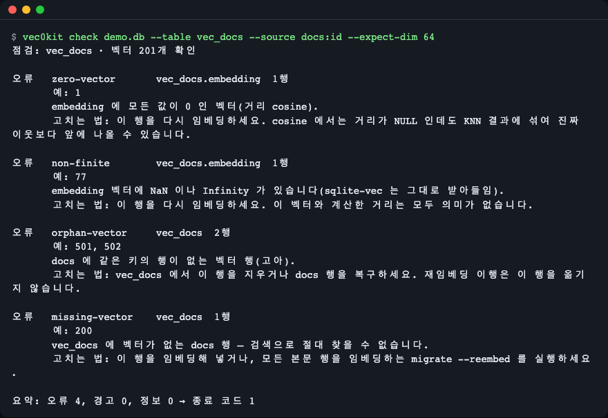
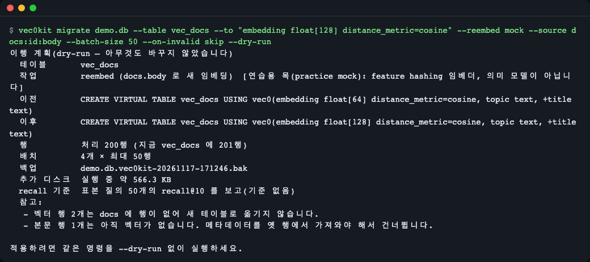
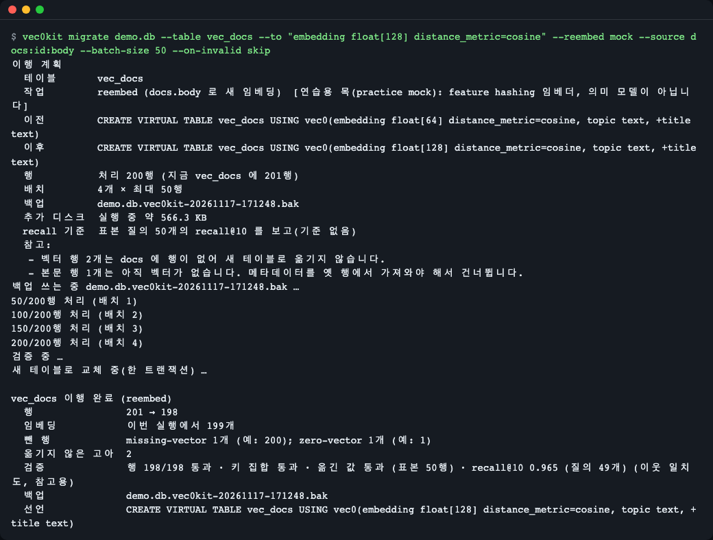
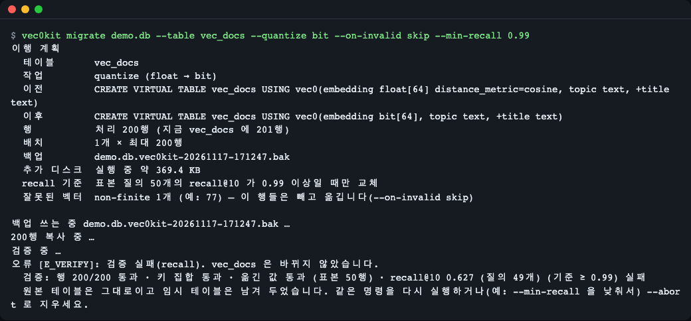
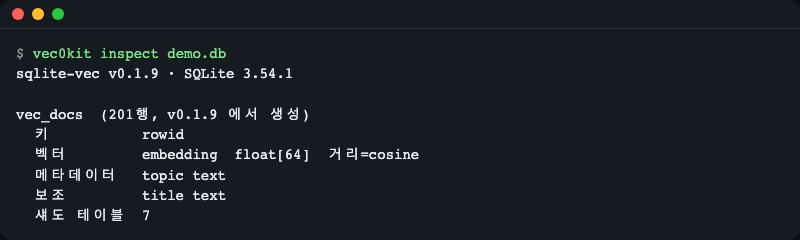
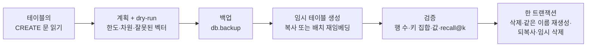

# vec0kit

[English](README.md) | **한국어**

[sqlite-vec](https://github.com/asg017/sqlite-vec) 의 `vec0` 테이블을 점검하고 안전하게 이행(마이그레이션)하는 CLI 입니다. `vec0` 테이블은 `ALTER TABLE` 로 바꿀 수 없어서, 임베딩 모델·거리 함수·양자화·메타데이터 열을 바꾸려면 보통 일회성 스크립트를 손으로 써야 합니다. `vec0kit migrate` 는 이 과정을 한 명령으로 합니다: 백업 → 새 테이블 생성 → 같은 rowid 로 복사 또는 재임베딩 → 검증 → 한 트랜잭션에서 같은 이름으로 다시 만들기.


*연습용 데이터베이스에서 `vec0kit check` 를 실행한 화면. 규칙 4개가 걸리고, 각각 규칙 ID·예시 rowid·고치는 법이 나옵니다.*

## 이런 분께

- 로컬 RAG·에이전트 메모리·MCP 서버의 임베딩을 sqlite-vec 에 두고, 384차원 모델에서 768차원 모델로 바꾸려는 분.
- `l2` 를 `cosine` 으로, float 를 int8/bit 로 바꾸되 적용 전에 recall 변화를 보고 싶은 분.
- 벡터 테이블과 문서 테이블이 어긋나면(고아·누락·0 벡터·NaN) CI 가 실패하게 하고 싶은 분.

데이터베이스는 파일 하나라서 앱이 어떤 언어로 만들어졌든 쓸 수 있습니다. CLI 자체는 Node.js 로 돌아갑니다.

## 설치

```bash
# Node.js 22.12 이상 (확인: node --version). 설치: https://nodejs.org 또는 `brew install node`
npm install -g vec0kit        # 설치 없이 쓰려면: npx vec0kit <명령>
```

클론해서 쓰는 방법 (아래 예제는 이 방법으로 실행했습니다):

```bash
git clone https://github.com/LeeGyeongPil/vec0kit && cd vec0kit
npm ci && npm run build
npx vec0kit --help      # 클론에서 빌드한 CLI 실행 (`npm link` 로 vec0kit 명령 등록도 가능)
```

런타임 의존성은 `better-sqlite3` 와 `sqlite-vec` 둘뿐이고 둘 다 미리 빌드된 바이너리가 들어 있어, 최소 리눅스 이미지에서도 컴파일러가 필요 없습니다. npm 이 `npm warn install-scripts … better-sqlite3` 경고를 내도 괜찮습니다. 패키지가 미리 빌드된 바이너리를 담고 있어 설치 스크립트 없이도 로드됩니다(깨끗한 복사본에서 `npm ci` 뒤 전체 테스트 통과로 확인).

## 빠르게 시작하기

```bash
npm start            # 클론한 폴더에서. 전역 설치했다면: vec0kit demo
```

`demo` 는 현재 폴더에 `demo.db` 를 만듭니다. `docs` 테이블에 문서 200개, `vec_docs float[64]` 벡터 테이블에는 일부러 문제를 심어 두었습니다(고아 벡터 2, 누락 벡터 1, 0 벡터 1, NaN 벡터 1). 그다음 `inspect`, `check`, `migrate --dry-run` 을 차례로 실행해 보여 줍니다. 네트워크도 키도 필요 없고, vec0kit 이 만들지 않은 `demo.db` 는 덮어쓰지 않습니다.

출력 (`--lang ko`):

```text
vec0kit 데모 — 연습용 데이터와 연습용 목(mock) 임베더(feature hashing, 의미 모델 아님). 네트워크가 필요 없습니다.
demo.db 를 만들었습니다: docs(200행)와 vec_docs float[64] cosine, 일부러 심은 문제:
  고아 벡터 2, 누락 벡터 1, 0 벡터 1(빈 문서), NaN 벡터 1

$ vec0kit inspect demo.db
sqlite-vec v0.1.9 · SQLite 3.54.1

vec_docs  (201행, v0.1.9 에서 생성)
  키           rowid
  벡터         embedding  float[64]  거리=cosine
  메타데이터   topic text
  보조         title text
  섀도 테이블  7
```

같은 실행에서 `check` 와 `migrate --dry-run` 이 이어서 나옵니다. 아래에서 하나씩 봅니다.

**연습용 목(mock).** `--reembed mock` 은 feature hashing 임베더입니다. 모델 없이 단어를 고정 크기 벡터로 바꿉니다. 의미를 이해하는 모델은 *아니지만* 결정적이고 오프라인으로 돌며, 실제 이행 경로(실제 `vec0` 테이블·배치·교체)를 그대로 타므로 실제 모델을 쓸 때와 같은 일이 일어납니다. 진짜 임베딩이 필요하면 `--reembed openai` 를 쓰세요([설정](#설정)). 이 모드는 임베딩 서버에 달려 있어서, 서버를 여럿이 쓰거나 모델이 크면 느릴 수 있습니다.

## 사용법

| 명령 | 하는 일 |
|---|---|
| `vec0kit inspect <db> [--table <이름>] [--json]` | 모든 `vec0` 테이블을 보여 줍니다: 벡터 열(타입·차원·거리), 키, 파티션·메타데이터·보조 열, 테이블 옵션, 행 수, 테이블을 만든 sqlite-vec 버전과 지금 로드된 버전. 읽기 전용. |
| `vec0kit check <db> [--table] [--source <테이블>:<키>] [--expect-dim <n>] [--expect-normalized] [--column] [--strict] [--json]` | 정합성 규칙을 실행합니다. error 가 있으면 종료 코드 1. 읽기 전용. |
| `vec0kit migrate <db> --table <이름> <변경…> [옵션]` | 백업·재구성·검증·교체. 변경 플래그(아래)가 하나 필요합니다. |
| `vec0kit demo [--db <경로>]` | 연습용 데이터베이스를 만들고 명령을 차례로 보여 줍니다. |

공통 옵션: `--json`, `--lang en|ko`, `-h/--help`, `-v/--version`. 종료 코드: `0` 정상, `1` 문제 발견 또는 검증 실패, `2` 사용법 오류 또는 계획 거부, `3` 실행 오류(예: 데이터베이스 잠김).

### `check` 규칙

| 규칙 | 심각도 | 뜻 |
|---|---|---|
| `orphan-vector` | error | `--source` 테이블에 행이 없는 키의 벡터. |
| `missing-vector` | error | 벡터가 없는 `--source` 행. 검색이 절대 찾을 수 없습니다. |
| `zero-vector` | `cosine` 이면 error, 아니면 warn | 모든 값이 0 인 벡터. cosine 에서는 거리가 NULL 인데도 KNN 결과에서 진짜 이웃보다 앞에 나올 수 있습니다. |
| `non-finite` | error | 벡터 안의 NaN 또는 Infinity(sqlite-vec 는 그대로 받아들입니다). |
| `norm-drift` | warn | `--expect-normalized` 일 때: 벡터 길이가 1 과 0.001 넘게 다릅니다. |
| `dim-mismatch` | error | `--expect-dim` 일 때: 테이블 차원이 지금 쓰는 임베딩 모델의 차원과 다릅니다. |
| `version-skew` | info | 테이블을 만든 sqlite-vec 버전과 지금 로드된 버전이 다릅니다. |
| `untested-version` | warn | 로드된 sqlite-vec 가 0.1.9(이 도구를 검증한 버전)가 아닙니다. |

### `migrate` 변경과 옵션

| 플래그 | 뜻 |
|---|---|
| `--to "<벡터 열>"` | 새 벡터 열 선언. 예: `"embedding float[768] distance_metric=cosine"`. 선언 전체를 쓰세요. `distance_metric` 을 빼면 기본값(`l2`)이 됩니다. |
| `--quantize int8\|bit` | float 열을 양자화합니다(bit 는 차원이 8 의 배수여야 함). |
| `--add-column "<열>"` / `--drop-column <이름>` | 파티션 키·메타데이터·보조 열을 추가하거나 뺍니다. sqlite-vec 0.1.9 는 메타데이터 열에 NULL 을 받지 않으므로 새 메타데이터 열에는 `--fill <열>=<본문 열>` 이 필요합니다. |
| `--reembed mock\|openai` | 텍스트로 새 임베딩을 계산합니다. 차원이 바뀌면 필수이고 `--source <테이블>:<키>:<텍스트 열>` 이 필요합니다. |
| `--source <테이블>:<키>[:<텍스트>]` | 문서가 들어 있는 테이블. |
| `--column <이름>` | 테이블에 벡터 열이 여럿일 때 대상 열. |
| `--batch-size <n>` | 임베딩 배치당 행 수(기본 1000). |
| `--min-recall <0..1>` | 표본 recall@k 가 이보다 낮으면 교체를 거부합니다(복사·양자화). |
| `--sample <n>`, `--k <n>` | 검증 질의 수(기본 50)와 질의당 이웃 수(기본 10). |
| `--on-invalid fail\|skip` | NaN·0 벡터: 아무것도 하기 전에 멈춤(기본) 또는 그 행을 빼고 진행하며 rowid 를 보고. |
| `--backup <경로>` / `--no-backup` | 백업 파일(기본 `<db>.vec0kit-YYYYMMDD-HHMMSS.bak`, 있는 파일은 덮어쓰지 않음) 또는 백업 없음. |
| `--dry-run` | 계획만 출력하고 아무것도 바꾸지 않습니다. |
| `--resume` / `--abort` | 끝나지 않은 실행을 이어서 하기(자동 감지) 또는 지우기. |

### 시나리오 1: 먼저 계획 보기

```bash
vec0kit migrate demo.db --table vec_docs \
  --to "embedding float[128] distance_metric=cosine" \
  --reembed mock --source docs:id:body --batch-size 50 --on-invalid skip --dry-run
```


*계획 화면: 무엇이 바뀌는지(이전/이후), 행과 배치 수, 백업 위치, 옮겨지지 않는 행에 대한 참고. 아무것도 쓰지 않았습니다.*

읽는 법: `이전`·`이후` 는 정확한 `CREATE VIRTUAL TABLE` 문이고, `행` 은 처리할 행 수이며, 참고에는 고아 벡터 2개는 옮기지 않고 벡터가 없는 문서 1개는 건너뛴다고 나옵니다.

### 시나리오 2: 재임베딩 실행

`--dry-run` 을 빼면 됩니다:

```text
백업 쓰는 중 demo.db.vec0kit-20261117-171219.bak …
50/200행 처리 (배치 1)
100/200행 처리 (배치 2)
150/200행 처리 (배치 3)
200/200행 처리 (배치 4)
검증 중 …
새 테이블로 교체 중(한 트랜잭션) …

vec_docs 이행 완료 (reembed)
  행                201 → 198
  임베딩            이번 실행에서 199개
  뺀 행             missing-vector 1개 (예: 200); zero-vector 1개 (예: 1)
  옮기지 않은 고아  2
  검증              행 198/198 통과 · 키 집합 통과 · 옮긴 값 통과 (표본 50행) · recall@10 0.965 (질의 49개) (이웃 일치도, 참고용)
  백업              demo.db.vec0kit-20261117-171219.bak
  선언              CREATE VIRTUAL TABLE vec_docs USING vec0(embedding float[128] distance_metric=cosine, topic text, +title text)
```


*실행이 끝난 뒤의 요약. 다른 모델은 다른 벡터를 만들기 때문에 recall 은 "이웃 일치도, 참고용"으로만 보이고 교체를 막지 않습니다.*

"처리"는 살펴본 200행이고, "임베딩 199개"는 실제로 임베더에 보낸 본문 수입니다. 옛 벡터가 없던 본문 행 1개는 건너뛰었기 때문입니다(`뺀 행` 참고).

이후 `vec0kit check demo.db --table vec_docs --source docs:id --expect-dim 128` 을 실행하면, 빼 둔 문서 2개(빈 문서와 벡터가 없던 문서)가 여전히 `missing-vector` 로 나옵니다. `--on-invalid skip` 의 정직한 결과입니다. 숨기지 않고 목록으로 보여 줍니다.

### 시나리오 3: recall 기준으로 양자화

아래 recall 수치는 새로 만든 `demo.db`(깨끗한 폴더에서 `vec0kit demo`) 기준이며, 시나리오 2를 이미 거친 데이터베이스에서는 값이 달라집니다.

```bash
vec0kit migrate demo.db --table vec_docs --quantize bit --on-invalid skip --min-recall 0.99
```


*표본 recall@10 이 0.627 로 기준 0.99 보다 낮아 교체가 거부됩니다. 종료 코드 1, 원본 테이블은 그대로이고 임시 테이블은 남아 있습니다.*

`--min-recall` 을 낮춰 다시 실행하면 검증된 복사본에서 이어서 하고, `--abort` 로 남은 것을 지울 수 있습니다:

```text
$ vec0kit migrate demo.db --table vec_docs --abort
vec_docs 의 끝나지 않은 이행(임시 테이블·상태)을 지웠습니다. 원본 테이블은 건드리지 않았습니다.
```

### 시나리오 4: 처음 보는 데이터베이스 파악

```bash
vec0kit inspect demo.db
```


*모든 정보는 테이블에 저장된 `CREATE VIRTUAL TABLE` 문에서 읽습니다. vec0kit 이 모르는 옵션은 원문 그대로 보존하고, 파싱할 수 없는 문은 추측하지 않고 오류로 처리합니다.*

## 이어서 하기와 중단

재임베딩은 배치마다 행과 진행 표시를 한 트랜잭션으로 저장하고, 느린 임베딩 호출은 트랜잭션 밖에서 합니다. 프로세스가 멈추면(Ctrl-C, 비정상 종료, 임베딩 서버 중단) 같은 명령을 다시 실행하세요. 느린 로컬 임베딩 서버를 상대로 Ctrl-C 로 멈추고 같은 명령을 다시 실행한 실제 출력입니다(영어 출력):

```text
Processed 50/200 rows (batch 1)
Stopping after this batch … (press Ctrl-C again to quit now)
Processed 100/200 rows (batch 2)
Stopped at 100/200. Finished batches are saved; run the same command again to continue, or --abort to discard.
(exit 130)

  resume       an unfinished run of this plan exists: 100/200 done — it will continue
Resuming: 100/200 already done
Processed 150/200 rows (batch 1)
Processed 200/200 rows (batch 2)
```

첫 Ctrl-C 는 현재 배치까지 저장하고 멈추며, 두 번째 Ctrl-C 는 즉시 종료합니다. 결과를 바꾸는 계획 요소(이전·이후 선언, 변경 종류, 복사 식, source, 임베더)가 같을 때만 이어서 합니다. 배치 크기·`--min-recall`·`--on-invalid` 는 해당하지 않으므로, recall 기준을 낮추거나 `--on-invalid skip` 을 붙여서 이어갈 수 있습니다. 그 밖에 다르면 `E_RESUME_MISMATCH` 와 `--abort` 안내로 멈춥니다.

복사·양자화 변경은 한 트랜잭션의 SQL `INSERT … SELECT` 한 문장이라 이어서 할 것이 없습니다. 중간에 끊기면 처음부터 다시 하며, 데이터는 손상되지 않습니다.

## 라이브러리로 쓰기

CLI 가 쓰는 함수를 그대로 내보냅니다(ESM, 타입 선언 포함).

```js
import { openDatabase, check, exitCodeForReport, planMigration, migrate, createMockEmbedder } from "vec0kit";

const db = openDatabase("demo.db");              // sqlite-vec 를 로드하고, 정수는 BigInt 로 받음
const report = check(db, { table: "vec_docs", source: { table: "docs", key: "id" }, expectDim: 64 });
console.log(report.summary, "exit would be", exitCodeForReport(report));
console.log(report.findings.map((f) => `${f.rule} x${f.count}`).join(", "));

const embedder = createMockEmbedder({ dims: 128 });
const plan = planMigration(db, {
  table: "vec_docs",
  to: "embedding float[128] distance_metric=cosine",
  reembed: embedder.id,                           // migrate() 에 넘기는 임베더와 같아야 함
  source: { table: "docs", key: "id", text: "body" },
  onInvalid: "skip",
});
const result = await migrate(db, plan, {
  embedder,
  backupPath: "demo.db.bak",
  onProgress: (p) => console.log(p.phase, p.done, "/", p.total),
});
console.log(result.rowsBefore, "->", result.rowsAfter);
db.close();
```

새로 만든 `demo.db` 에서의 출력:

```text
{ error: 4, warn: 0, info: 0, rowsScanned: 201 } exit would be 1
zero-vector x1, non-finite x1, orphan-vector x2, missing-vector x1
backup 0 / 200
embed 200 / 200
verify 200 / 200
swap 198 / 198
201 -> 198
```

그 밖의 내보내기: `inspect`, `parseVec0Declaration`, `formatVec0Declaration`, `abortMigration`, `createOpenAIEmbedder`, 그리고 `code` 를 가진 `Vec0KitError`(`E_PARSE`, `E_NO_TABLE`, `E_PLAN`, `E_LIMIT`, `E_INVALID_VECTORS`, `E_VERIFY`, `E_RESUME_MISMATCH`, `E_LOCKED`, `E_EMBED`, `E_EXTENSION`, `E_USAGE`, `E_NO_DB`, `E_NOT_DB`). 앱 시작 때 `check()` 를 부르고 `report.summary.error > 0` 이면 로그를 남기는 식으로 쓸 수 있습니다.

## CI 에서 쓰기

```bash
vec0kit check app.db --table vec_docs --source docs:id --expect-dim 768 --json
echo $?     # 0 문제 없음, 1 error 발견 (경고에도 실패하려면 --strict)
```

`--json` 은 규칙 ID·메시지 키·rowid 표본만 출력하므로 두 언어에서 바이트 단위로 같습니다. JavaScript 안전 범위를 넘는 큰 정수는 문자열로 출력됩니다.

## 설정

`--reembed openai` 는 OpenAI 호환 `/embeddings` 엔드포인트(예: 로컬 Ollama)와 통신합니다. `.env.example` 을 복사해 값을 export 하세요. 그 밖의 기능에는 키가 필요 없습니다.

| 변수 | 뜻 |
|---|---|
| `VEC0KIT_LANG` | `en` 또는 `ko`. 순서: `--lang`, `VEC0KIT_LANG`, `LC_ALL`, `LC_MESSAGES`, `LANG`. 한국어가 아니면 영어. |
| `VEC0KIT_EMBED_URL` | 기준 URL. 예: `http://localhost:11434/v1`. |
| `VEC0KIT_EMBED_MODEL` | 모델 이름. 예: `nomic-embed-text`. |
| `VEC0KIT_EMBED_API_KEY` | 선택. 있으면 `Authorization: Bearer …` 로 보냅니다. |

```bash
export VEC0KIT_EMBED_URL=http://localhost:11434/v1
export VEC0KIT_EMBED_MODEL=nomic-embed-text
vec0kit migrate app.db --table vec_docs \
  --to "embedding float[768] distance_metric=cosine" \
  --reembed openai --source docs:id:body
```

OpenAI 호환 경로는 테스트에서 로컬 스텁 서버로만 확인했고 실제 Ollama 나 호스팅 API 로는 실행하지 않았습니다. 실제 데이터에 끝까지 돌려 본 임베더는 목 임베더뿐입니다.

**화면 언어.** `--lang ko`(또는 `VEC0KIT_LANG=ko`)를 주면 한국어로 출력합니다. 모든 메시지·규칙 설명·표가 번역되고 `--json` 은 같게 유지됩니다. 영어 출력 스크린샷은 [README.md](README.md) 에 있습니다.

## 동작 원리



- **읽기.** 선언을 `sqlite_master` 에서 파싱하므로 특정 앱의 스키마가 아니어도 됩니다.
- **계획.** `--reembed` 없는 차원 변경, 메타데이터 열 16개 초과, 8 의 배수가 아닌 bit 양자화 차원, cosine 테이블로 가는 NaN·0 벡터는 파일을 바꾸기 전에 여기서 거부합니다.
- **백업.** 일관된 스냅숏(WAL 포함)을 먼저 씁니다.
- **생성.** 새 테이블은 같은 rowid 를 씁니다. 복사는 SQL `INSERT … SELECT` 한 문장이라 값이 JavaScript 숫자를 거치지 않습니다(2^53 반올림 없음). 재임베딩은 키 순서로 읽고 트랜잭션 밖에서 임베딩합니다.
- **검증.** 행 수, 타입까지 구분하는 키 집합 해시(정수 1 과 문자열 "1" 은 다름), 메타데이터·보조 값 표본, 표본 KNN recall@k.
- **RENAME 없이 교체.** sqlite-vec 0.1.9 에서는 `ALTER TABLE … RENAME` 이 섀도 테이블 이름을 바꾸지 않아 테이블이 깨집니다(이 도구를 만들며 확인, 상위 [이슈 #125](https://github.com/asg017/sqlite-vec/issues/125) 참고). 그래서 교체는 옛 테이블 삭제 → 같은 이름·새 선언으로 재생성 → 임시 테이블에서 되복사 → 임시 삭제를 모두 한 `BEGIN IMMEDIATE` 트랜잭션에서 합니다. `vec0` DDL 은 트랜잭션과 함께 롤백됩니다. 대가는 벡터 데이터를 두 번 복사한다는 점이며, `--dry-run` 이 필요한 추가 디스크를 보여 줍니다. 테스트가 실행된 SQL 에 `RENAME` 이 없음을 확인합니다.

붙박이장의 칸 크기는 바꿀 수 없으니, 새 장을 세우고 번호표(rowid)대로 물건을 옮겨 개수를 센 뒤에야 옛 장 자리에 새 장을 놓는다고 생각하면 됩니다.

`migrate` 전에는 데이터베이스를 쓰는 앱을 멈추세요. 다른 연결이 쓰기 잠금을 쥐고 있으면 vec0kit 은 아무것도 바꾸기 전에 `E_LOCKED`(종료 3)로 멈춥니다.

## 이 도구가 확인하는 함정

- **cosine 의 0 벡터.** 거리가 NULL 이 되고 KNN 결과에서 진짜 이웃보다 앞에 올 수 있습니다(앞에 오는지는 스캔 순서에 달려 있음). `check` 가 표시하고, `migrate` 는 `--on-invalid skip` 이 없으면 시작 전에 멈춥니다.
- **NaN / Infinity** 는 sqlite-vec 가 받아들이지만 그 벡터와의 모든 거리는 의미가 없습니다.
- **큰 정수.** 2^53 보다 큰 rowid·INTEGER 메타데이터도 이행 후 정확히 보존됩니다(`9007199254740993` 으로 테스트).
- **한도.** 메타데이터 열은 최대 16개(sqlite-vec 0.1.9 가 그 이상을 거부), 메타데이터 열은 NULL 을 받지 않습니다.
- **버전.** sqlite-vec 는 1.0 이전입니다. 의존성은 0.1.9 로 고정했고 다른 버전이면 `untested-version` 이 경고합니다.

## 언제 쓰나

- 잘 맞는 경우: 이미 sqlite-vec 에 벡터를 두고 있고 차원·거리·양자화·열을 바꿔야 하거나, CI 에서 벡터 테이블을 지키고 싶을 때.
- 다루지 않는 것: 열 이름 변경, 기본 키·`chunk_size` 변경, 앱이 쓰는 중의 무중단 이행, 벡터 열이 여럿인 테이블의 동시 재임베딩, 임베딩 모델 품질 평가.
- 다른 도구: 확장과 문서는 [sqlite-vec](https://github.com/asg017/sqlite-vec) 프로젝트, Node 에서 불러오는 법은 [sqlite-vec JS 가이드](https://alexgarcia.xyz/sqlite-vec/js.html).

## 자주 겪는 문제

| 증상 | 원인 | 해결 |
|---|---|---|
| `error [E_LOCKED]`(종료 3) | 다른 프로세스가 쓰기 잠금을 쥐고 있음. | 데이터베이스를 쓰는 앱을 멈추고 다시 실행. |
| 시작 전에 `error [E_INVALID_VECTORS]` | NaN 이나 0 벡터가 cosine 테이블로 들어가려 함. | 그 행을 다시 임베딩하거나, `--on-invalid skip` 으로 빼고 보고서에서 rowid 확인. |
| `error [E_VERIFY]` 와 남은 임시 테이블 | recall(또는 다른 검사) 실패. 원본은 그대로. | `--min-recall` 을 낮춰 다시 실행하거나 `--abort` 로 지우기. |
| `error [E_RESUME_MISMATCH]` | 다른 계획의 끝나지 않은 실행이 있음. | 같은 옵션으로 실행하거나 먼저 `--abort`. |
| `error [E_PLAN]: New metadata column year cannot be NULL` | sqlite-vec 0.1.9 는 메타데이터 열에 NULL 을 받지 않음. | `--fill year=<본문 열>` 추가. |
| 차원을 바꿀 때 `E_PLAN` | 새 차원에는 새 벡터가 필요함. | `--reembed` 와 `--source <테이블>:<키>:<텍스트>` 추가. |
| `--on-invalid skip` 뒤에도 `check` 가 `missing-vector` 를 보고 | 건너뛴 행은 설계상 옮겨지지 않음. | 본문 텍스트를 고쳐 임베딩하거나, skip 없이 `migrate --reembed` 다시 실행. |
| `npm warn install-scripts … better-sqlite3` | npm 이 실행하지 않는 설치 스크립트를 알림. | 무시. 미리 빌드된 바이너리가 들어 있어 테스트도 통과합니다. |

## 개발

```bash
npm ci
npm run build
npm test            # 테스트 77개, 네트워크·키 없음
```

이 환경에서 확인한 조합: macOS arm64, Node v26.13.0, better-sqlite3 13.2.0, sqlite-vec 0.1.9(SQLite 3.54.1). CI 는 Ubuntu·macOS 에서 Node 22·24·26 을 돌립니다. 이슈와 제안은 환영합니다. 변경 기록은 [CHANGELOG.md](CHANGELOG.md).

## 라이선스

MIT. 데모 문서는 `src/demo-corpus.ts` 코드가 만들어 내며(역시 MIT) 외부 데이터셋이나 모델은 내려받지 않습니다.
