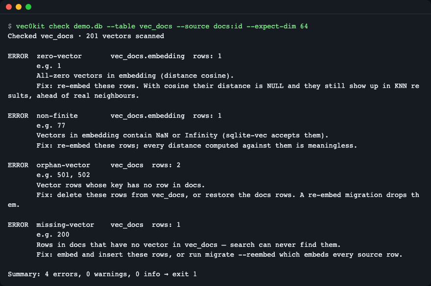
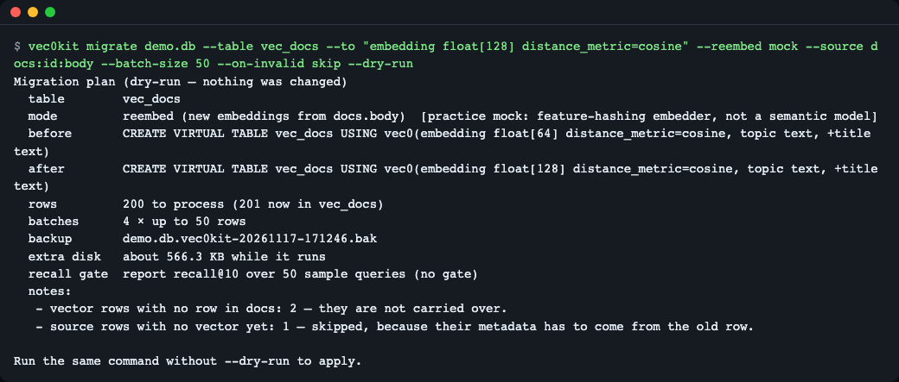
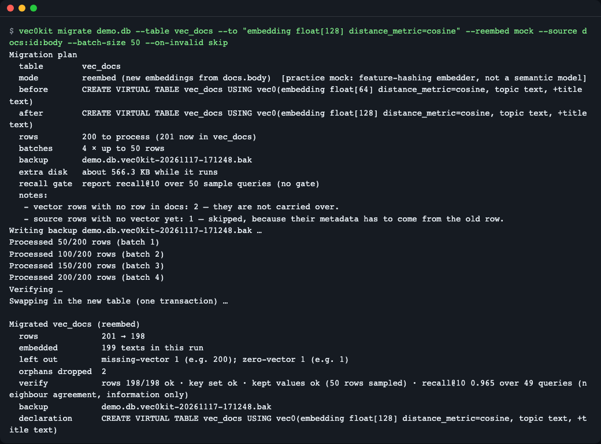
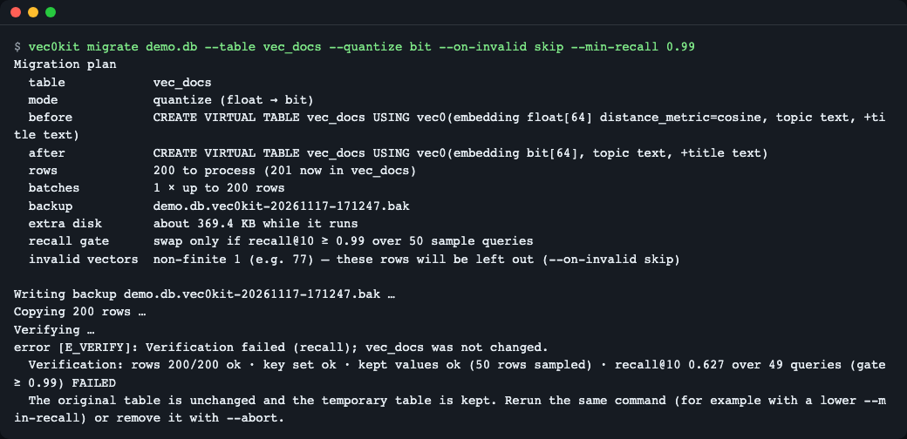
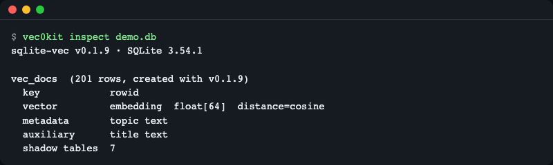
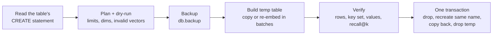

# vec0kit

**English** | [한국어](README.ko.md)

Inspect, check and safely migrate [sqlite-vec](https://github.com/asg017/sqlite-vec) `vec0` tables. A `vec0` table cannot be altered, so changing the embedding model, distance metric, quantization or a metadata column normally means a hand-written one-off script. `vec0kit migrate` does that as one command: backup, build a new table, copy or re-embed every row under the same rowid, verify, and recreate the table under the same name in one transaction.


*`vec0kit check` on the practice database: four rules fire, each with a rule ID, example rowids and how to fix it.*

## Who it is for

- You keep embeddings in sqlite-vec (local RAG, agent memory, an MCP server) and are about to switch from a 384-dimension to a 768-dimension model.
- You want to go from `l2` to `cosine`, or from float to int8/bit, and want to see the recall change before you commit to it.
- You want CI to fail when the vector table and the document table drift apart (orphans, missing vectors, zero vectors, NaN).

The database is just a file, so it works whatever language your app is written in. The CLI itself runs on Node.js.

## Install

```bash
# Node.js 22.12 or newer (check with: node --version). Install: https://nodejs.org or `brew install node`
npm install -g vec0kit        # or run it without installing: npx vec0kit <command>
```

From a clone (this is what the examples below were run with):

```bash
git clone https://github.com/LeeGyeongPil/vec0kit && cd vec0kit
npm ci && npm run build
npx vec0kit --help      # run the built CLI from the clone (or `npm link` for a global vec0kit command)
```

Runtime dependencies are only `better-sqlite3` and `sqlite-vec`, both with prebuilt binaries. On a minimal Linux image no compiler is needed. If npm prints `npm warn install-scripts … better-sqlite3`, you can ignore it: the package ships its prebuilt binary and loads without running an install script (verified by `npm ci` followed by the full test run in a clean copy).

## Quick start

```bash
npm start            # from a clone; with a global install: vec0kit demo
```

`demo` creates `demo.db` in the current folder: 200 documents in a `docs` table and a `vec_docs float[64]` vector table with problems planted on purpose (2 orphan vectors, 1 missing vector, 1 zero vector, 1 NaN vector). It then runs `inspect`, `check` and a `migrate --dry-run` for you. It needs no network and no key. It refuses to overwrite a `demo.db` it did not create.

Output (`--lang en`):

```text
vec0kit demo — practice data and the practice mock embedder (feature hashing, not a semantic model). No network needed.
Created demo.db: docs (200 rows) and vec_docs float[64] cosine, with planted problems:
  2 orphan vectors, 1 missing vector, 1 zero vector (an empty document), 1 NaN vector

$ vec0kit inspect demo.db
sqlite-vec v0.1.9 · SQLite 3.54.1

vec_docs  (201 rows, created with v0.1.9)
  key            rowid
  vector         embedding  float[64]  distance=cosine
  metadata       topic text
  auxiliary      title text
  shadow tables  7
```

The `check` and `migrate --dry-run` parts follow in the same run; they are shown one by one below.

**Practice mock.** `--reembed mock` uses a feature-hashing embedder: it turns words into a fixed-size vector without any model. It is *not* a semantic model, but it is deterministic and offline, and it takes the real migration path (real `vec0` tables, real batches, real swap), so what you see is what happens with a real model. For real embeddings use `--reembed openai` (see [Configuration](#configuration)); that mode depends on your embedding server and can be slow when the server is shared or the model is large.

## Usage

| Command | What it does |
|---|---|
| `vec0kit inspect <db> [--table <name>] [--json]` | Lists every `vec0` table: vector columns (type, dimensions, distance), key, partition / metadata / auxiliary columns, table options, row count, the sqlite-vec version that created the table and the version loaded now. Read-only. |
| `vec0kit check <db> [--table] [--source <table>:<key>] [--expect-dim <n>] [--expect-normalized] [--column] [--strict] [--json]` | Runs consistency rules. Exit code 1 when an error is found. Read-only. |
| `vec0kit migrate <db> --table <name> <change…> [options]` | Backup, rebuild, verify, swap. Needs one change flag (below). |
| `vec0kit demo [--db <path>]` | Creates the practice database and walks through the commands. |

Common options: `--json`, `--lang en|ko`, `-h/--help`, `-v/--version`. Exit codes: `0` ok, `1` problems found or verification failed, `2` usage error or plan rejected, `3` runtime error (for example the database is locked).

### `check` rules

| Rule | Severity | Meaning |
|---|---|---|
| `orphan-vector` | error | A vector whose key has no row in the `--source` table. |
| `missing-vector` | error | A `--source` row with no vector, so search can never find it. |
| `zero-vector` | error with `cosine`, warn otherwise | All-zero vector. With cosine its distance is NULL, yet it can still appear in KNN results ahead of real neighbours. |
| `non-finite` | error | NaN or Infinity inside a vector (sqlite-vec accepts them). |
| `norm-drift` | warn | With `--expect-normalized`: vector length differs from 1 by more than 0.001. |
| `dim-mismatch` | error | With `--expect-dim`: the table's dimensions differ from your current embedding model's. |
| `version-skew` | info | The table was created by another sqlite-vec version than the one loaded now. |
| `untested-version` | warn | The loaded sqlite-vec is not 0.1.9 (the version this tool was verified against). |

### `migrate` changes and options

| Flag | Meaning |
|---|---|
| `--to "<vector column>"` | New vector column declaration, for example `"embedding float[768] distance_metric=cosine"`. Write the whole declaration: leaving out `distance_metric` means the default (`l2`). |
| `--quantize int8\|bit` | Quantize a float column (bit needs a dimension divisible by 8). |
| `--add-column "<column>"` / `--drop-column <name>` | Add or remove a partition key, metadata or auxiliary column. A new metadata column needs `--fill <col>=<source column>` because sqlite-vec 0.1.9 does not accept NULL there. |
| `--reembed mock\|openai` | Compute new embeddings from text. Required when the dimensions change. Needs `--source <table>:<key>:<text column>`. |
| `--source <table>:<key>[:<text>]` | The table that holds your documents. |
| `--column <name>` | Which vector column, when the table has several. |
| `--batch-size <n>` | Rows per embedding batch (default 1000). |
| `--min-recall <0..1>` | Refuse to swap when the sampled recall@k is lower (copy and quantize). |
| `--sample <n>`, `--k <n>` | Verification queries (default 50) and neighbours per query (default 10). |
| `--on-invalid fail\|skip` | NaN or zero vectors: stop before doing anything (default) or leave those rows out and report their rowids. |
| `--backup <path>` / `--no-backup` | Backup file (default `<db>.vec0kit-YYYYMMDD-HHMMSS.bak`; an existing file is never overwritten) or no backup. |
| `--dry-run` | Print the plan and change nothing. |
| `--resume` / `--abort` | Continue an unfinished run (found automatically) or remove it. |

### Scenario 1: see the plan first

```bash
vec0kit migrate demo.db --table vec_docs \
  --to "embedding float[128] distance_metric=cosine" \
  --reembed mock --source docs:id:body --batch-size 50 --on-invalid skip --dry-run
```


*The plan: what changes (before / after), how many rows and batches, where the backup goes, and notes about rows that will not be carried over. Nothing was written.*

Read it as: `before` and `after` are the exact `CREATE VIRTUAL TABLE` statements; `rows` is what will be processed; the notes say 2 orphan vectors are dropped and 1 document without a vector is skipped.

### Scenario 2: run the re-embed

Drop `--dry-run`:

```text
Writing backup demo.db.vec0kit-20261117-171218.bak …
Processed 50/200 rows (batch 1)
Processed 100/200 rows (batch 2)
Processed 150/200 rows (batch 3)
Processed 200/200 rows (batch 4)
Verifying …
Swapping in the new table (one transaction) …

Migrated vec_docs (reembed)
  rows             201 → 198
  embedded         199 texts in this run
  left out         missing-vector 1 (e.g. 200); zero-vector 1 (e.g. 1)
  orphans dropped  2
  verify           rows 198/198 ok · key set ok · kept values ok (50 rows sampled) · recall@10 0.965 over 49 queries (neighbour agreement, information only)
  backup           demo.db.vec0kit-20261117-171218.bak
  declaration      CREATE VIRTUAL TABLE vec_docs USING vec0(embedding float[128] distance_metric=cosine, topic text, +title text)
```


*The summary after a completed run. Because a different model produces different vectors, recall is shown as "neighbour agreement, information only" and does not gate the swap.*

"Processed" counts the 200 rows that were looked at; "embedded 199" counts the texts actually sent to the embedder, because the one source row without an old vector was skipped (see `left out`).

Running `vec0kit check demo.db --table vec_docs --source docs:id --expect-dim 128` afterwards still reports `missing-vector` for the two documents that were left out (the empty one and the one that had no vector). That is the honest result of `--on-invalid skip`: they are listed, not hidden.

### Scenario 3: quantize with a recall gate

The recall numbers below come from a freshly created `demo.db` (run `vec0kit demo` in a clean folder); a database that already went through Scenario 2 gives different values.

```bash
vec0kit migrate demo.db --table vec_docs --quantize bit --on-invalid skip --min-recall 0.99
```


*Sampled recall@10 was 0.627, below the 0.99 gate: the swap is refused, exit code 1, the original table is unchanged and the temporary table is kept.*

Rerun with a lower `--min-recall` to continue from the verified copy, or remove the leftovers with `--abort`:

```text
$ vec0kit migrate demo.db --table vec_docs --abort
Removed the unfinished migration of vec_docs (temporary table and state). The original table was not touched.
```

### Scenario 4: look at a database you do not know

```bash
vec0kit inspect demo.db
```


*Everything is read from the table's stored `CREATE VIRTUAL TABLE` statement; options vec0kit does not know are kept verbatim and a statement it cannot parse is an error, never a guess.*

## Resume and abort

Re-embedding writes each batch and its progress marker in one transaction, and the slow embedding call happens outside any transaction. If the process stops (Ctrl-C, a crash, the embedding server going away), run the same command again. Real output from stopping a run with Ctrl-C against a slow local embedding server and running the same command again:

```text
Processed 50/200 rows (batch 1)
Stopping after this batch … (press Ctrl-C again to quit now)
Processed 100/200 rows (batch 2)
Stopped at 100/200. Finished batches are saved; run the same command again to continue, or --abort to discard.
(exit 130)

  resume       an unfinished run of this plan exists: 100/200 done — it will continue
Resuming: 100/200 already done
Processed 150/200 rows (batch 1)
Processed 200/200 rows (batch 2)
```

The first Ctrl-C finishes the current batch and stops; a second one quits at once. A rerun is accepted only when the result-defining parts of the plan are identical (old and new declaration, kind of change, copy expressions, source, embedder). Batch size, `--min-recall` and `--on-invalid` are not part of that, so you can lower the recall gate or add `--on-invalid skip` and continue. Anything else stops with `E_RESUME_MISMATCH` and a hint to use `--abort`.

Copy and quantize changes are a single SQL `INSERT … SELECT` in one transaction, so there is nothing to resume; if they are interrupted they start over, and your data is not harmed.

## Use as a library

The same functions the CLI uses are exported (ESM, with type declarations).

```js
import { openDatabase, check, exitCodeForReport, planMigration, migrate, createMockEmbedder } from "vec0kit";

const db = openDatabase("demo.db");              // loads sqlite-vec; integers come back as BigInt
const report = check(db, { table: "vec_docs", source: { table: "docs", key: "id" }, expectDim: 64 });
console.log(report.summary, "exit would be", exitCodeForReport(report));
console.log(report.findings.map((f) => `${f.rule} x${f.count}`).join(", "));

const embedder = createMockEmbedder({ dims: 128 });
const plan = planMigration(db, {
  table: "vec_docs",
  to: "embedding float[128] distance_metric=cosine",
  reembed: embedder.id,                           // must match the embedder you pass to migrate()
  source: { table: "docs", key: "id", text: "body" },
  onInvalid: "skip",
});
const result = await migrate(db, plan, {
  embedder,
  backupPath: "demo.db.bak",
  onProgress: (p) => console.log(p.phase, p.done, "/", p.total),
});
console.log(result.rowsBefore, "->", result.rowsAfter);
db.close();
```

Output on a fresh `demo.db`:

```text
{ error: 4, warn: 0, info: 0, rowsScanned: 201 } exit would be 1
zero-vector x1, non-finite x1, orphan-vector x2, missing-vector x1
backup 0 / 200
embed 200 / 200
verify 200 / 200
swap 198 / 198
201 -> 198
```

Other exports: `inspect`, `parseVec0Declaration`, `formatVec0Declaration`, `abortMigration`, `createOpenAIEmbedder`, and `Vec0KitError` with a `code` (`E_PARSE`, `E_NO_TABLE`, `E_PLAN`, `E_LIMIT`, `E_INVALID_VECTORS`, `E_VERIFY`, `E_RESUME_MISMATCH`, `E_LOCKED`, `E_EMBED`, `E_EXTENSION`, `E_USAGE`, `E_NO_DB`, `E_NOT_DB`). Call `check()` at app start-up and log when `report.summary.error > 0`.

## Use in CI

```bash
vec0kit check app.db --table vec_docs --source docs:id --expect-dim 768 --json
echo $?     # 0 clean, 1 an error was found (add --strict to fail on warnings too)
```

`--json` prints rule IDs, message keys and rowid samples only, so the output is byte-identical in both languages. Large integers outside JavaScript's safe range are printed as strings.

## Configuration

`--reembed openai` talks to any OpenAI-compatible `/embeddings` endpoint (for example a local Ollama). Copy `.env.example` and export the values; nothing else needs a key.

| Variable | Meaning |
|---|---|
| `VEC0KIT_LANG` | `en` or `ko`. Order: `--lang`, `VEC0KIT_LANG`, `LC_ALL`, `LC_MESSAGES`, `LANG`; anything that is not Korean falls back to English. |
| `VEC0KIT_EMBED_URL` | Base URL, e.g. `http://localhost:11434/v1`. |
| `VEC0KIT_EMBED_MODEL` | Model name, e.g. `nomic-embed-text`. |
| `VEC0KIT_EMBED_API_KEY` | Optional. Sent as `Authorization: Bearer …` when set. |

```bash
export VEC0KIT_EMBED_URL=http://localhost:11434/v1
export VEC0KIT_EMBED_MODEL=nomic-embed-text
vec0kit migrate app.db --table vec_docs \
  --to "embedding float[768] distance_metric=cosine" \
  --reembed openai --source docs:id:body
```

The OpenAI-compatible path was tested only against a local stub server in the test suite, not against a live Ollama or hosted API. The mock embedder is the only embedder run end to end against real data here.

**Language.** Pass `--lang ko` (or set `VEC0KIT_LANG=ko`) to get Korean output; every message, rule explanation and table is translated, and `--json` stays identical. The screenshots in [README.ko.md](README.ko.md) show the Korean output.

## How it works



- **Read.** The declaration is parsed from `sqlite_master`, so any schema works, not only one app's.
- **Plan.** Dimension changes without `--reembed`, more than 16 metadata columns, a bit quantization whose dimension is not a multiple of 8, and NaN or zero vectors headed for a cosine table are rejected here, before any file changes.
- **Backup.** A consistent snapshot (WAL included) is written first.
- **Build.** The new table gets the same rowids. Copies are one SQL `INSERT … SELECT`, so values never pass through JavaScript numbers (no 2^53 rounding); re-embedding reads in key order and embeds outside any transaction.
- **Verify.** Row count, a type-aware key-set hash (integer 1 is not text "1"), sampled metadata and auxiliary values, and sampled KNN recall@k.
- **Swap without RENAME.** In sqlite-vec 0.1.9, `ALTER TABLE … RENAME` does not rename the shadow tables and breaks the table (observed while building this tool; see the upstream [issue #125](https://github.com/asg017/sqlite-vec/issues/125)). So the swap drops the old table, recreates the same name with the new declaration, copies back from the temporary table and drops it, all in one `BEGIN IMMEDIATE` transaction. `vec0` DDL rolls back with the transaction. The price is that vector data is copied twice; `--dry-run` shows the extra disk needed. The test suite asserts that no executed SQL contains `RENAME`.

Think of a built-in cupboard whose shelf sizes cannot be changed: you build a new cupboard, move every item over by its numbered tag (the rowid), count them, and only then put the new one where the old one stood.

Stop the app that uses the database before you run `migrate`. If another connection holds the write lock, vec0kit stops with `E_LOCKED` (exit 3) before it changes anything.

## Pitfalls this tool checks

- **Zero vectors under cosine.** Their distance is NULL, and they can show up in KNN results ahead of real neighbours (whether they lead depends on scan order). `check` flags them; `migrate` stops before starting unless `--on-invalid skip`.
- **NaN / Infinity** are accepted by sqlite-vec; every distance against them is meaningless.
- **Large integers.** Rowids and INTEGER metadata above 2^53 survive a migration exactly (covered by tests with `9007199254740993`).
- **Limits.** At most 16 metadata columns (sqlite-vec 0.1.9 rejects more). Metadata columns do not accept NULL.
- **Version.** sqlite-vec is pre-1.0; dependencies are pinned to 0.1.9 and `untested-version` warns on anything else.

## When to use it

- Good fit: you already store vectors in sqlite-vec and need to change dimensions, metric, quantization or columns, or want CI to guard the vector table.
- Not covered: renaming columns, changing the primary key or `chunk_size`, a zero-downtime migration while the app is writing, several vector columns re-embedded at once, and judging embedding model quality.
- Other tools: the [sqlite-vec](https://github.com/asg017/sqlite-vec) project itself for the extension and its documentation; [sqlite-vec's JS guide](https://alexgarcia.xyz/sqlite-vec/js.html) for loading it from Node.

## Troubleshooting

| Symptom | Cause | Fix |
|---|---|---|
| `error [E_LOCKED]` (exit 3) | Another process holds the write lock. | Stop the app that uses the database and run again. |
| `error [E_INVALID_VECTORS]` before anything starts | NaN or zero vectors would go into a cosine table. | Re-embed those rows, or add `--on-invalid skip` to leave them out and see their rowids in the report. |
| `error [E_VERIFY]` and a leftover temporary table | Recall (or another check) failed; the original is untouched. | Rerun with a lower `--min-recall`, or remove it with `--abort`. |
| `error [E_RESUME_MISMATCH]` | An unfinished run exists for a different plan. | Use the same options, or `--abort` first. |
| `error [E_PLAN]: New metadata column year cannot be NULL` | sqlite-vec 0.1.9 does not accept NULL in metadata columns. | Add `--fill year=<source column>`. |
| `error [E_PLAN]: N rows have no value for new metadata column …` | Orphan vectors (no row in the source table) or NULL in the `--fill` source column; the message lists example rowids. | Run `check --source <table>:<key>`, then delete the orphans or restore the source rows (or use `--reembed`); otherwise fill the column or pick another `--fill` column. |
| `E_PLAN` on a dimension change | The new dimensions need new vectors. | Add `--reembed` and `--source <table>:<key>:<text>`. |
| `check` still reports `missing-vector` after `--on-invalid skip` | Skipped rows are not carried over, by design. | Fix the source text and embed them, or re-run `migrate --reembed` without skipping. |
| `npm warn install-scripts … better-sqlite3` | npm notes an install script it does not run. | Ignore: the prebuilt binary is bundled and tests pass without it. |

## Development

```bash
npm ci
npm run build
npm test            # 79 tests, no network, no keys
```

Verified here on macOS arm64 with Node v26.13.0, better-sqlite3 13.2.0, sqlite-vec 0.1.9 (SQLite 3.54.1). CI runs Node 22, 24 and 26 on Ubuntu and macOS. Issues and suggestions are welcome. Changes are listed in [CHANGELOG.md](CHANGELOG.md).

## License

MIT. The demo corpus is generated by code in `src/demo-corpus.ts` (also MIT); no external dataset or model is downloaded.
